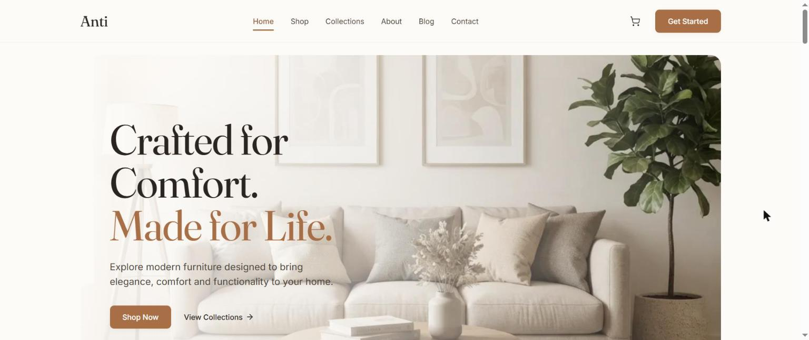
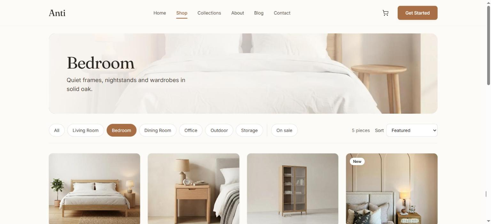
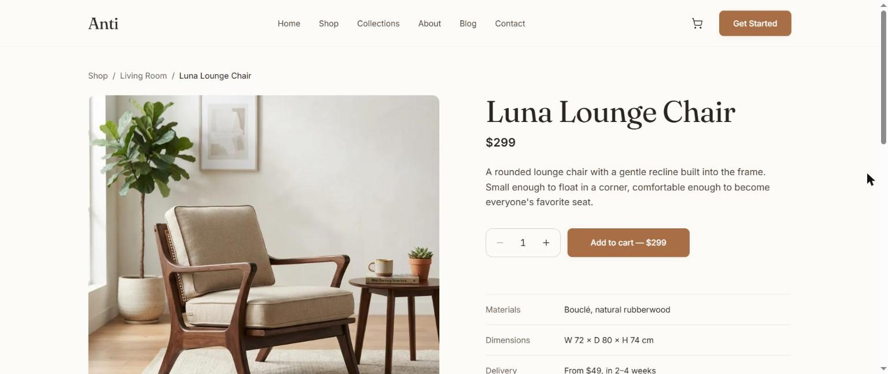

<h1> Anti — Furniture Store</h1>

A calm, modern online store for a furniture brand. Browse by room, open any piece to see its details, and add it to your cart.

**Live demo:** [antistore.vercel.app](https://antistore.vercel.app)



## What you can do

- **Shop by room**: filter by living room, bedroom, office and more, show items on sale, and sort by price. Your filters stay in the link, so you can share them.
- **Product pages**: photos, price, materials, sizes, delivery info and related pieces.
- **Cart**: change quantities, see your savings, and watch a bar fill up as you get close to free delivery. Your cart is saved even if you close the page.
- **More pages**: collections, a blog, an about page and a contact form that checks your input.





## Nice touches

- Works on phones, tablets and computers, with a slide-in menu on small screens.
- Easy to use with a keyboard, and less motion for people who prefer it.
- Light, fast images that load as you scroll.

## Built with

React 19, React Router 7, Tailwind CSS and Vite.

---

<div dir="rtl">

<h2> Anti — متجر أثاث</h2>

متجر أونلاين هادي وعصري لبراند أثاث. تقدر تتصفح المنتجات حسب الأوضة، تفتح أي قطعة وتشوف تفاصيلها، وتضيفها للسلة.

- **تسوّق حسب الأوضة:** فلترة للصالة وأوضة النوم والمكتب وغيرهم، وعرض العروض، وترتيب بالسعر. الفلاتر بتتحفظ في اللينك فتقدر تبعتها لحد.
- **صفحة المنتج:** صور وسعر وخامات ومقاسات ومعلومات التوصيل وقطع مشابهة.
- **السلة:** تغيّر الكميات، وتشوف وفّرت قد إيه، وشريط بيوضح فاضلك قد إيه على التوصيل المجاني. والسلة بتفضل محفوظة حتى لو قفلت الصفحة.
- **صفحات تانية:** الكوليكشنز، والمدونة، ومن نحن، وفورم تواصل بيراجع البيانات.
- شغال على الموبايل والتابلت والكمبيوتر.

</div>

---

## Run it on your computer

```bash
npm install
npm run dev
```

Then open http://localhost:5173.

> I built this site from a UI design I came across and liked, turning it into a working, responsive website. Products, prices and reviews are demo data, and product photos from Unsplash are credited on each product page.

---

Made by **Samaa Abo Diab** · تم التنفيذ بواسطة **سماء أبو دياب** · [LinkedIn](https://www.linkedin.com/in/samaa-abo-diab)
